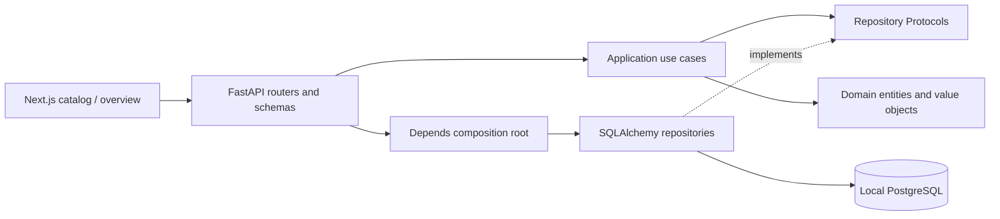

# Architecture overview

The catalog and overview flow from a Next.js server component to the local FastAPI API, through a constructor-injected application use case, through repository Protocols implemented by SQLAlchemy adapters, and into PostgreSQL. API schemas map domain values explicitly. Browser interaction uses the graph already retrieved from the backend.

## Domain

Universe is the top-level identity, not a tree root. Continuities identify adaptations or other explicitly separated bodies of knowledge. Nodes represent heterogeneous entities and edges retain both direction and semantic relationship type. A node may participate in arbitrarily many relationships, including cycles.

`Slug` validates URL-safe identifiers. Node and relationship enums provide a deliberate application vocabulary. Persisted type strings avoid native database enum evolution overhead; adding a type still requires a coordinated domain/contract change. Unknown persisted strings fail explicitly rather than being misclassified.

An edge validates endpoint identity and universe equality. Scoped endpoints must agree on continuity; the edge must retain that scope. Shared endpoints can connect within a specified continuity. Two explicitly shared endpoints may have a shared edge or a continuity-specific edge. Composite foreign keys enforce universe ownership in storage, including continuity ownership. Cross-adaptation compatibility remains domain policy; all future mutation paths must invoke endpoint validation. There is no mutation API in this phase.

## Application and composition

Only `UniverseRepository` and `GraphRepository` are ports. Each is a meaningful persistence/test substitution boundary. ListUniverses, GetUniverse, GetUniverseGraph and GetNodeDetails receive their dependencies through constructors. Frozen result DTOs aggregate graph and detail responses without depending on HTTP.

FastAPI Depends providers are the composition root. The cached request session is shared by both repositories; its yield dependency opens a transaction, commits on success, rolls back on failure and closes. Graph reads are sequential because AsyncSession cannot be shared across concurrent tasks. Engine creation happens in application lifespan; shutdown disposes its pool. No engine is opened merely by importing domain or application modules.

## Persistence and API

Tables have UUID keys, timezone-aware timestamps, indexed graph access paths and JSONB node metadata. Alembic migrations are self-contained. Repositories perform explicit ORM-to-domain mapping; HTTP responses never serialize ORM objects.

Graph responses separate `nodes`, `edges`, `continuities`, and `universe`. Edge `source`/`target` attributes are adapter-friendly without making domain objects depend on Sigma. Layout belongs in the frontend. Current reads return a complete small graph; large-graph query bounds and paging are deferred.

The health endpoint probes database connectivity. Not-found, validation and unavailable persistence responses have stable error codes and messages. Unexpected failures remain server errors and are not misreported as successful data.

## Frontend

App Router server components fetch fresh local API data with a timeout and no persistent cache. `API_BASE_URL` stays server-only. Catalog and overview include framework loading, error and not-found boundaries. The catalog has an empty state. Atlas owns selection, text search and continuity filtering, including incoming/outgoing relationship traversal. This component is the future Sigma boundary. There are no frontend sample records, remote fonts, paid assets or inference calls.

## Verification strategy

Domain and application tests run with pure values and fakes. API and repository tests use a fresh in-memory SQLite database with foreign keys enabled, proving serialization and DI without touching a developer database. An opt-in PostgreSQL test requires a clearly named test database, creates a random schema, applies actual Alembic migrations, seeds twice, exercises API retrieval, downgrades and removes the schema. Type checks and lint cover both languages; the frontend production build checks the App Router compilation.

## Deferred work

Ollama, LangChain, LangGraph, SearXNG, embeddings, SSE, Sigma and GSAP are outside Phase 1. No placeholder agents or fabricated research results are included. Provenance, claim-level evidence, research job state and editing endpoints need their own design before ingestion is added.
