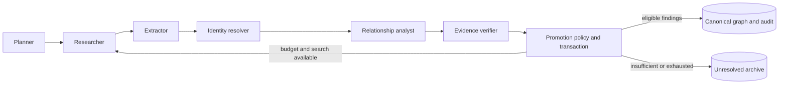

# Phase 3, increment 2: autonomous knowledge publication

This increment extends the existing LangChain/LangGraph research worker. It resolves identities, proposes typed relationships, verifies evidence and publishes eligible findings through a transactional application service. Publication is automatic; there is no approval queue. An accepted model assessment alone does not establish canonical truth.

See [executed verification and live limitations](phase-3-increment-2-verification.md), [quotation-free live audit](phase-3-increment-2-demo.json), and [changed files](phase-3-increment-2-files.txt). Earlier increment 1 documentation describes the historical archive-only implementation.

## Workflow and boundaries



`ResearchWorkflow` retains its archive-only four-role mode for callers that do not inject knowledge dependencies. `build_workflow` composes `KnowledgePipeline`, `IdentityResolver`, and `CanonicalGraphPromotionService` for the production worker. These are working components, without future-agent placeholders. Existing archive claims store proposed entities and relationships; new tables do not duplicate the claim archive.

The worker persists application-owned snapshots at completed node boundaries. Resume skips finished stages. These are not native LangGraph checkpoints: a process lost inside an inference call can repeat that node. The worker's PostgreSQL advisory lock serializes worker ownership; scope transaction locks serialize publication independently. Network and model calls happen outside short archive/publication transactions. No `AsyncSession` is shared by concurrent tasks.

Execution remains bounded by settings: one inference at a time by default, at most three iterations, twenty sources and ten search queries. Selected passages use round-robin source coverage, at most eight passages and 4,000 characters. Optional `extraction_types` requests focused extraction, with at most two coverage passes and three entities per type, twelve entities overall. The analyst proposes at most six additional relationships; the candidate set is capped at twenty-four. Missing model output is not replaced with invented findings. An unavailable verifier leaves its atomic claim insufficient and allows other claims to continue.

## Identity resolution

`domain/knowledge.py` preserves original names while deriving NFKC, case, punctuation and whitespace normalized retrieval keys. Script detection and Latin name-order keys help candidate retrieval; neither proves identity. There is no automatic Japanese romanizer or embeddings index.

`IdentityResolver.resolve` retrieves at most eight same-type, same-continuity candidates, including aliases, descriptions and neighboring relationships. The structured model compares evidence and returns `SAME_ENTITY`, `DIFFERENT_ENTITY`, `NEW_ENTITY`, or `AMBIGUOUS`, with citations and an explicit type-validity assessment. A scoped exact name or explicit source-backed bilingual/alias bridge is required to accept a match. Source co-occurrence and a shared surname cannot establish a merge. A conflicting alias bridge, reusable bare title, partial name or exhausted retrieval bound blocks creation rather than forcing a duplicate.

An introductory official bilingual heading connected `ナツキ・スバル` to existing `Subaru Natsuki` and `エミリア` to existing `Emilia`. The resolver reused the original UUIDs. This live result is distinct from the owned synthetic identity tests. Hidden identity annotations receive stronger policy and are excluded from ordinary alias reads.

## Relationships and verification

`KnowledgePipeline.relationships` receives resolved identity IDs and actual source passages. The vocabulary preserves existing `CAUSED` (not a new `CAUSES` synonym), participation, location, alliance and other graph types. It adds `OPPOSED`, `MEMBER_OF`, `RELATED_TO`, `PRECEDES`, and `ENABLED`, with matching frontend transport values.

Verification first validates exact contiguous quotations, passage IDs and offsets, actual entity references and graph scope. The model then assesses an atomic assertion against bounded cross-source passages, including contradiction, continuity, in-world relevance and entity-type flags. A real-world publicity location and a person mislabeled as an event must not become fictional graph knowledge. Contradictions and adaptation ambiguity remain visible.

Publication repeats evidence checks and loads actual current nodes inside its transaction. `GraphRelationship.validate_endpoints` runs before graph mutation. Participation targets an event, location connects an event to a place, and membership targets a faction. Causal edges require event endpoints, explicit causal language and literal event anchors consistent with direction. Temporal order does not imply causation. These structural rules supplement semantic assessment; they are not a general natural-language entailment engine.

## Automatic policy

`PromotionPolicy` has three outcomes: `AUTO_PROMOTE`, `RESEARCH_FURTHER`, and `KEEP_UNRESOLVED`. No confidence score is used. All accepted claims need exact evidence, supported assessment, accepted identity/endpoints, valid structure, compatible scope and no material conflict.

| Assertion | Default minimum independent source families |
| --- | --- |
| Existing identity/ordinary alias, event, location, participation | 1 |
| New character identity | 2 |
| Causality, enabling, revelation or hidden identity | 2 |

`PROMOTION_MINIMUM_SOURCES` and `PROMOTION_STRONG_SOURCES` configure these limits; strong claims use the greater threshold and always require at least two. New-character creation is stronger than reuse of an evidenced existing character. It is not automatically classified as a hidden identity.

Sources with identical document hashes, near-identical quotations or the same publisher family do not count independently. An explicit `source_group` conservatively merges likely derivative sources and cannot split a publisher to manufacture corroboration. Publisher-family heuristics cannot reliably detect all syndication or copying.

`RESEARCH_FURTHER` triggers the existing search path only when a search provider, source/query capacity and iteration budget remain. Otherwise the decision becomes `KEEP_UNRESOLVED`. Unresolved claims do not prevent unrelated valid publication.

## Transactions, history and correction

`CanonicalGraphPromotionService.publish` owns a `KnowledgeTransaction` context containing archive and graph ports. It locks the scope and job, reloads current claims and canonical state, checks cancellation and evidence, and writes nodes/edges, aliases, decision history and immutable publication evidence atomically. Repositories flush but never commit. Database composite foreign keys retain universe/continuity ownership.

Claim-based publication uniqueness and deterministic IDs make replay idempotent. Natural relationship keys reuse an existing directed edge. A second concurrent job with a stale new-entity proposal is preserved unresolved for another resolution pass instead of creating the same normalized identity twice. Exact-name collisions are not blindly merged.

Rollback records a reason and retraction timestamp. It removes only research-owned, unchanged targets with no remaining active support or unrelated incident relationship. Seed records and user edits are retained. The repository follows the original creator record even if another job supplies the last surviving evidence. Individual promotion and whole-job corrections are supported; retracted assertions do not silently reactivate on replay. New contradictory assessments can withdraw an earlier publication. Correction history remains inspectable after a target is removed.

## Persistence and API

Additive, self-contained Alembic migrations:

- `39ed89ae0cf9`: `entity_aliases`, `knowledge_decisions`, `promotion_records`, `promotion_evidence`, scoped foreign keys, indexes and downgrade operations.
- `a133bb90a692`: nullable `source_documents.independence_key`, preserving historical documents.

New observability/correction routes:

- `GET /api/research/jobs/{job_id}/knowledge`: resolution/assessment/policy decisions, publication records and summary.
- `GET /api/nodes/{node_id}/aliases`: nonsensitive aliases and active supporting claims/sources.
- `POST /api/research/jobs/{job_id}/rollback`: body `{ "reason": "specific correction reason" }`.
- `POST /api/research/promotions/{promotion_id}/rollback`: targeted correction with the same reason body.

Existing findings gain additive `canonical_id` and `promotion_id` fields. Graph/node reads support optional repeated `allowed_source_id` parameters and `curated_only=true`; source-fenced aliases use the same source set. A research target is visible only when an active publication's evidence belongs to the allowed set; curated records remain visible. Sensitive aliases are omitted. The caller must supply the correct spoiler/source boundary: this is not an automatic per-user spoiler system or authentication layer. Default graph reads include published research. The current frontend has no research controls and was not redesigned.

Imported text may include an HTTP(S) `reference_url` for attribution. This does not fetch that URL, grant permission, or classify the import as public cloud-eligible content. `start_at` and `end_before` delimit exact source selections and fail closed on missing markers. Selection and import content affect the source cache key. Original source hashes, offsets, permission statements and continuity scope are retained locally. Only actively published claims enter prior-knowledge context; insufficient or retracted claims cannot silently become established knowledge.

## Running and inspecting

Apply `python -m alembic upgrade head` from `services/intelligence` with the root venv. Start the API and queue a bounded research request through `/docs`. Imported material must be permitted and scoped to the requested adaptation. Then run:

```powershell
..\..\.venv\Scripts\python -m src.research_worker --once --job-id <job-uuid>
```

Inspect the job, findings, events and knowledge endpoints. Events remain JSON records, not SSE. Local Ollama is sufficient; Groq remains optional behind the existing explicit cloud-content permission gate. Identity/relationship calls containing private canonical context remain local. No credentials, source-body exports or local databases belong in Git.

## Learning from the actual code

- **Dependency inversion:** `CanonicalGraphPromotionService` accepts the `KnowledgeTransaction` Protocol, not a SQLAlchemy session. The production async context manager in `research_runtime.py` supplies `SqlResearchRepository` and `SqlKnowledgeRepository` sharing one transaction. Tests substitute isolated sessions without changing publication policy.
- **Composition:** `KnowledgePipeline` composes an identity resolver and promotion service. `ResearchWorkflow` coordinates these roles; no `BaseAgent` inheritance hierarchy is needed.
- **Domain purity:** `PromotionPolicy`, `name_key`, and `relation_structure` use standard-library values and enums. They do not import FastAPI, Pydantic or ORM metadata.
- **Typed transport boundaries:** dedicated Pydantic schemas validate structured inference and HTTP output. ORM rows become domain objects before endpoint validation; the API does not serialize a session-bound model.
- **Unit of work and concurrency:** a successful publication commits graph mutations and provenance together. A failing write rolls back both. Scope advisory locks and uniqueness constraints address races that an in-process semaphore alone cannot prevent.

## Limits and next increment

The live small-model runs demonstrate entity extraction, bilingual reconciliation, automatic publication, retraction and replay. They do not yet demonstrate dependable end-to-end relationship discovery. See the executed report for exact final results. Semantic assessments remain fallible: earlier runs promoted incorrect records, subsequently withdrawn through audited correction. Do not describe these assessments as independent verification.

Shared (`None`) continuity records remain conservative: this resolver's catalog uses the requested exact continuity and does not automatically reconcile shared records across adaptations. Novel event paraphrases can remain separate candidates; there is no global semantic duplicate merger. Hidden identities, changing names and alternate forms are preserved unresolved without an explicit bridge. Automatic general transliteration, large-graph paging, semantic RAG, embeddings, native LangGraph checkpoints, SSE, frontend research controls, deployment and cloud storage remain absent.

Next, build a small permitted-source evaluation corpus focused on event boundaries, multilingual identity bridges and relationship entailment. Improve observed failures and measure precision/recall before expanding agents or loosening promotion rules. Test real Groq routing only with explicit content-sharing permission.
