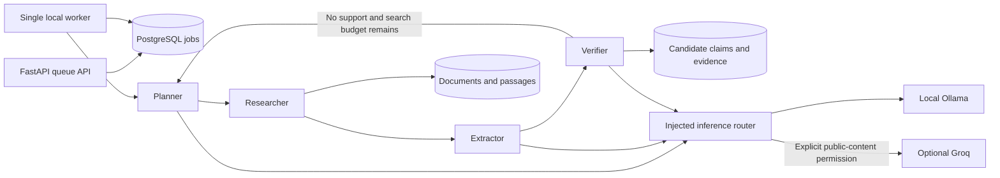

# Phase 3, increment 1: persistent source-backed research

This increment implements one real LangGraph workflow: **Planner → Researcher → Extractor → Verifier**. It does not implement the entire Phase 3 architecture diagram. The existing atlas and canonical graph remain unchanged. Research findings live in a separate archive and are never automatically promoted into graph nodes or edges.

## Run locally

Install the updated backend lockfile as described in README, start PostgreSQL, and run these commands from `services/intelligence`:

```powershell
..\..\.venv\Scripts\python -m alembic upgrade head
..\..\.venv\Scripts\python -m uvicorn src.main:app --host 127.0.0.1 --port 8000
```

In a second terminal in the same directory:

```powershell
..\..\.venv\Scripts\python -m src.research_worker
# Or process one queued job and exit:
..\..\.venv\Scripts\python -m src.research_worker --once
# Restrict that invocation to a particular queued UUID:
..\..\.venv\Scripts\python -m src.research_worker --once --job-id <UUID>
```

Ollama must be running with the configured chat model installed. No model is downloaded automatically. Imported permitted text works without a search service or Internet connection; it still requires local Ollama inference. Public URL retrieval needs Internet access.

Use [local Swagger](http://127.0.0.1:8000/docs) or this PowerShell example from any directory:

```powershell
$graph = Invoke-RestMethod 'http://127.0.0.1:8000/api/universes/re-zero/graph'
# Inspect $graph.continuities and choose the intended adaptation explicitly.
$continuityId = $graph.continuities[0].id # Current illustrative database has one continuity.
$body = @{
    universe_id = $graph.universe.id
    continuity_id = $continuityId
    objective = 'Identify characters explicitly described in the introductory premise. Use original names and one literal source-language fact per character. Omit relationships whose type is not supported.'
    allow_search = $false
    sources = @(@{
        url = 'https://www.tv-tokyo.co.jp/anime/re-zero/story/'
        permission_basis = 'Bounded local research from a public broadcaster synopsis; no republication of the source body.'
        source_scope = 'Original TV anime introductory premise only.'
    })
} | ConvertTo-Json -Depth 6
$job = Invoke-RestMethod 'http://127.0.0.1:8000/api/research/jobs' -Method Post -ContentType 'application/json' -Body ([Text.Encoding]::UTF8.GetBytes($body))
Invoke-RestMethod "http://127.0.0.1:8000/api/research/jobs/$($job.id)"
Invoke-RestMethod "http://127.0.0.1:8000/api/research/jobs/$($job.id)/findings"
```

Alternatively supply `text` and an optional `title` instead of `url`, with a truthful permission basis and adaptation scope. Exactly one input is required per source. Declaring a permission basis does not establish a license or bypass retrieval restrictions. Public accessibility and robots permission do not grant unrestricted republication rights.

## API contract

| Endpoint | Behavior |
| --- | --- |
| `POST /api/research/jobs` | Validate universe/continuity and source policy, persist a queued job, return 202. Does not run an inference in the request. |
| `GET /api/research/jobs/{id}` | Status, last completed stage, iteration and sanitized provider usage. |
| `GET /api/research/jobs/{id}/findings` | Candidate payloads, decisions and evidence references; always `canonical: false`. No new inference. |
| `GET /api/research/jobs/{id}/events` | Ordered, persisted JSON events. This is **not SSE**. |
| `POST /api/research/jobs/{id}/cancel` | Cooperative cancellation, checked between roles and acquisitions. Cannot interrupt an already running model generation immediately. |
| `GET /api/ai/providers/status` | Probe the installed Ollama model; report configured cloud aliases without probing Groq or exposing keys. Worker cooldown is process-local and is not represented by this fresh API router instance. |

`completed` means the current extraction has at least one candidate and every candidate received support, without acquisition errors. `partial` means the bounded workflow ended with missing support or acquisition errors; inspect individual decisions. `failed` means a sanitized execution/provider error stopped the job. Missing, fabricated or duplicate verifier assessments never imply support. Duplicate spellings can still be distinct candidates: completion does not mean identity reconciliation or human approval.

## Architecture and dependency injection



- Domain source/passages use standard-library dataclasses, immutable content hashes, deterministic passage IDs and character offsets.
- `application/ports/research.py` defines meaningful repository, transaction, acquisition and search Protocols. Application DTOs and provider contracts validate structured outputs with Pydantic. No domain import depends on LangChain, SQLAlchemy or FastAPI.
- `infrastructure/research_runtime.py` composes the concrete archive, fetcher, optional search and injected inference router. Tests substitute inference and acquisition explicitly; production roles have no hardcoded lore results.
- `orchestration/research_workflow.py` defines the actual four-node `StateGraph`. The model plans and extracts; the Researcher executes approved acquisition tools. The Verifier checks exact quotations first, validates relationship endpoints through the domain, then asks the model to assess individual claims against their excerpts. One claim per verification call avoids incomplete batch assessments observed with the installed 4B model.
- Repositories never commit. Every archive operation opens a short caller-owned transaction and closes its session. Network and model calls happen outside those transactions. A separate connection holds a PostgreSQL session advisory lock so only one worker runs; no long-running database transaction spans inference.
- The worker persists jobs independently of HTTP clients. Stage snapshots support restart from the next unfinished role. Interrupted `running` jobs are requeued on worker startup. Acquisition and claim writes use stable identities; work between snapshots may repeat after a crash. Completed/partial identical requests are reused for 24 hours; deduplication is best effort for simultaneous submissions.
- Checkpoints are application-owned PostgreSQL snapshots at node boundaries, **not LangGraph's native checkpointer**. No time travel, mid-node continuation or exactly-once inference is claimed.

To learn the boundaries, trace `QueueResearch.execute` into `SqlResearchRepository.create_job`, then follow the worker into `ResearchWorkflow.run`. Compare the Protocols with `FakeInference` in tests: substitution changes the test dependency, while the production orchestration remains identical. Trace `save_claim` separately from graph repositories to see why model approval cannot silently mutate canon.

## Providers, privacy and limits

Configuration is in `.env.example`. Settings read the repository-root `.env`, then the current-directory `.env`, with process environment taking precedence. Existing `GROQ_API_KEY_PRIMARY`, `GROQ_API_KEY_SECONDARY` and `GROQ_MODEL` names are preserved. Credentials never appear in API usage records or SDK error bodies; only aliases such as `primary` are recorded. LangSmith tracing is explicitly disabled around both graph and inference execution, including when enabled in the environment.

| Mode | Routing |
| --- | --- |
| `local` | Ollama only, regardless of cloud credentials. |
| `hybrid` | Planning/extraction local; verification may prefer Groq only when cloud sharing is enabled and all acquired content is public web material. Otherwise local. |
| `cloud` | Eligible public-content tasks prefer Groq, with local fallback. Private planning/imported-document context remains local. This workflow intentionally does not mark planning/extraction prompts eligible. |

Cloud requires `AI_CLOUD_CONTENT_ALLOWED=true`, a configured model and a nonempty credential. The default is false. Ollama's configured endpoint must be loopback. Provider model availability is checked through the provider's actual model list. LangChain uses Ollama JSON-schema output and Groq tool-based structured output, followed by Pydantic validation. A Groq model lacking tool support falls back to local after bounded failures; there is no JSON-mode compatibility fallback yet.

Timeouts, attempts, concurrent inference, iterations, query count, source count, source byte/character size and context passages are bounded. A 429 places all Groq aliases on a shared cooldown (at least 60 seconds or the numeric Retry-After interval) and falls back locally; it never rotates to the second key to bypass that limit. Authentication failures disable the failing alias. Cooldown/disabled state is in worker memory and resets on restart; account-wide rate coordination across restarts is not implemented. Failed attempt token counts may be unavailable and are recorded as zero, not estimated success usage.

Public acquisition uses an explicit host allowlist, robots checks, per-host request spacing, public-IP DNS checks, a pinned connection and TLS hostname validation. Redirect destinations are rechecked, private/reserved destinations are rejected, and scripts/navigation are stripped. It does not bypass login, paywalls or anti-bot pages. Documents are bounded and may be truncated; metadata records that fact. Source scope is declared and model-reviewed, not independently proven adaptation identity.

SearXNG is a real optional loopback JSON-search adapter. Without `SEARXNG_BASE_URL`, requests must supply URLs or text; `allow_search=true` is rejected. No search service was installed or used for this demonstration. Retrieval currently selects at most eight deterministic stored passages, not semantic RAG. Wider source coverage is not guaranteed.

## Migration and database preservation

Revision `a7f742b8d4c5`, after `0001_atlas`, adds seven archive tables: `research_jobs`, `source_documents`, `source_passages`, `research_claims`, `claim_evidence`, `research_events` and `provider_usage`. It adds lookup/queue indexes and scope-aware composite foreign keys, with a full downgrade. Existing graph tables, rows, enum vocabulary and seed IDs are preserved. Do not downgrade the development archive to experiment: downgrade removes archive records. Tests exercise downgrade only in a uniquely named schema in an explicit `_test` database.

The live database retains the original **15 canonical nodes and 25 edges**. Source-backed research is separate from illustrative seeds. There are no graph write or automatic promotion endpoints.

## Actual demonstration and limitations

See [the captured real-run audit](phase-3-demo.json) and [executed verification](phase-3-verification.md). The successful run used actual Ollama `qwen3.5:4b`, real retrieval of the [TV Tokyo introductory synopsis](https://www.tv-tokyo.co.jp/anime/re-zero/story/), persisted passages and exact evidence checks. The audit omits source bodies/quotations and copied model prose; the local archive retains evidence and offsets. English descriptions in the audit are clearly labeled report paraphrases.

Two supported candidate claims describe Subaru's arrival and disorientation. The model emitted `菜月昴` and `スバル` as separate entity candidates, despite the objective asking for two characters. **This is two claims about Subaru, not two independently identified people.** Alias/entity resolution is not implemented and no canonical duplication occurred. The successful run extracted no relationships. Relationship persistence is exercised by clearly labeled synthetic tests, not presented as real lore discovery.

Two earlier live runs remain in the archive as `partial`. One omitted most batch assessments; another was overstrict about translated paraphrases and emitted unsupported relationship types. These failures informed single-claim verification and source-language extraction. Their outputs were not relabeled as successful findings. Model support remains fallible and correlated because extraction and verification can use the same model.

Not implemented in this increment: embeddings/pgvector, semantic ranking, full coverage research, native LangGraph persistence, durable account-wide cloud throttling, SSE, relationship/narrative specialist agents, media acquisition, automated adaptation classification, alias reconciliation, human review/promotion, narrative API generation, frontend agent controls or scheduling. The embedding model setting reserves a configuration name; it does not imply embeddings run. Groq wiring and fallback policy are tested with fakes; live Groq inference was **not** performed while cloud sharing was disabled.

Next increments should add identity reconciliation and human review, then scoped local embeddings/retrieval with explicit coverage reporting, before connecting accepted archive content to frontend narrative contracts. Introduce further roles only when an observed pipeline need justifies them.
